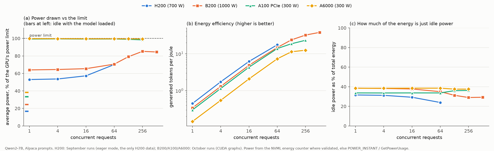
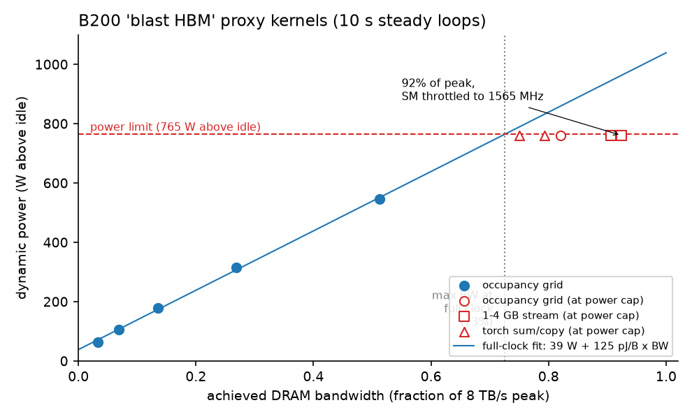
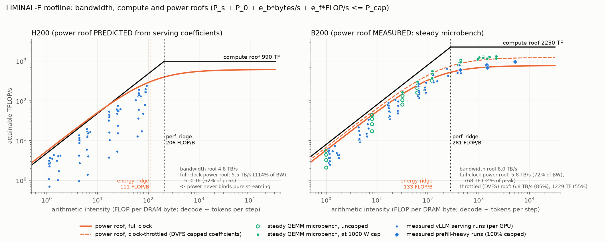
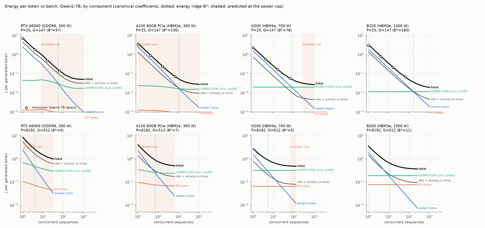
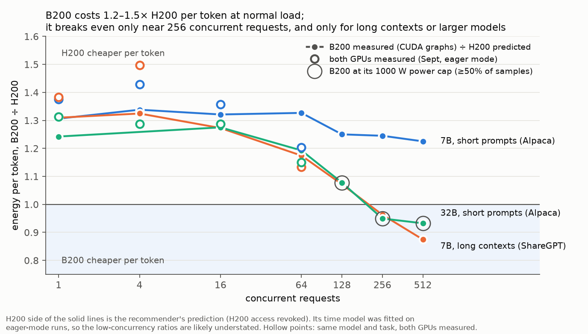
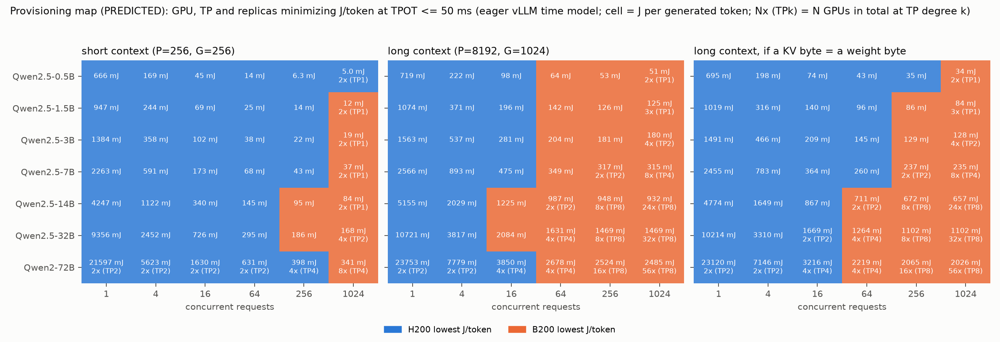

# Energy Efficiency of LLM Serving on GPUs: Measured Results and LIMINAL-E

Status as of 2026-10-22. Branch vllm_ragged (fork arjunds/efficient-ai). Sources for every number are listed in the appendix.

## Summary

- **GPUs rarely draw their TDP, unless they are power-limited.** For a 7B model, H200 draws 53–70% of its 700 W limit and B200 draws 64–85% of its 1000 W. The A100 PCIe and RTX A6000 sit at their 300 W limit at every load we tried.
- **Idle power is a first-class cost.** Just keeping a GPU powered with the model loaded accounts for about 25–40% of all serving energy at ordinary loads, on every GPU.
- **Energy per byte read from memory is nearly constant across HBM generations:** 1.07–1.37×10⁻¹⁰ J/B on A100, H200 and B200. GDDR6 (A6000) costs about 2× per byte. Compute energy per FLOP improves about 2× per generation: 2.64 pJ on A6000, 1.47 on A100, 0.77 on B200.
- **The inverse-bandwidth assumption is false.** B200 has 1.67× H200's bandwidth, but each byte costs 1.16–1.2× more, not 0.6× as the assumption predicted. That holds for the DRAM channel alone, too.
- **Per token, at normal load (up to 64 concurrent requests): H200 < B200 (about 1.3–1.4×) < A100 (about 1.5×) < A6000 (about 3.5×).** B200 loses to H200 mainly because it idles at 238 W against 116 W, and its extra speed doesn't repay that at moderate load. B200 breaks even or wins (0.87–0.95×) only around 256+ concurrent requests, with long contexts or larger models. At those loads it sits at its 1000 W cap.
- **We extended LIMINAL's roofline with measured energy terms and a power roof (LIMINAL-E).**
  - It predicts energy per token within 2.7–3.9% on the GPUs it was calibrated on.
  - Zero-shot from microbenchmarks only, it gets 7.0% (A100) and 8.2% (A6000). LIMINAL's TDP-based power model gets 61% overall and 87.5% on H200.
  - It shows power, not bandwidth or FLOPs, is the binding roof on A6000, A100 and B200.
- **The data behind this:** 445 serving runs on 5 GPU types (0.5B–72B dense plus MoE, 1–512 concurrent requests); steady-state microbenchmarks on B200, A100, A6000 and A5000; and hardware-counter (NCU) validation of byte counts to within 1%.

## 1. How much power do GPUs actually draw?

| GPU | Memory | Power limit (TDP) | Idle, no process / model loaded | Serving power, Qwen2-7B (low → high load) | % of limit | Power-limited? |
|---|---|---|---|---|---|---|
| H200 | HBM3e 141 GB, 4.8 TB/s | 700 W | not measured / 116 W | 371 → 491 W (1 → 64 concurrent) | 53–70% | No: its power roof sits above its bandwidth roof |
| B200 | HBM3e 180 GB, 8 TB/s | 1000 W | not measured / 238–247 W | 640 → 852 W (1 → 512) | 64–85% | At high load and prefill: 32B at ≥128 concurrent, 95–99% of samples at the cap; prefill 100% |
| A100 80GB PCIe | HBM2e, 1.94 TB/s | 300 W | 47.5 W / 98–100 W | 296–298 W at every load | ~99% | Always, for dense models |
| RTX A6000 | GDDR6 48 GB, 0.77 TB/s | 300 W | 32.5 W / 86 W (115 W right after load) | 298–299 W at every load | ~100% | Always |



*Figure 1. Qwen2-7B, Alpaca prompts. (a) Average power as a percentage of each GPU's limit, with idle (model loaded) as the bars at left. (b) Generated tokens per joule. (c) Share of energy that is idle power. H200 data is September eager mode (H200 access has since been revoked); the other GPUs are October runs with CUDA graphs.*

| Tokens per joule (Qwen2-7B, Alpaca) | 1 concurrent | 64 concurrent | 256 concurrent |
|---|---|---|---|
| H200 | 0.45 | 17.5 | not measured |
| B200 | 0.34 | 14.8 | 32.1 |
| A100 PCIe | 0.30 | 13.8 | 23.2 |
| RTX A6000 | 0.15 | 7.3 | 12.5 |

**What this means:**
- **TDP is a poor proxy for power on H200 and B200,** and a good one on A100 and A6000.
  - A TDP × time model (as in LIMINAL) is off by about 10% on the capped parts but 87.5% on H200.
  - An activity-dependent energy model is necessary for the GPUs that matter most.
- **Idle power is roughly a third of all energy at normal loads** (H200 24–32%, B200 29–39%, A100 34–36%, A6000 about 38%). It falls only slowly with load, so a provisioned-but-underused GPU is expensive.
- **Idle depends on state.**
  - An A100 draws 47.5 W with no process, but about 99 W once any CUDA process is alive. Its clocks stay pinned at 1410 MHz, with no decay after 90 s.
  - An A6000 drops back to lower clocks on its own.
  - Fleet policy (detaching or powering down idle serving processes) changes the idle term by up to 2×.

## 2. What the hardware coefficients show

These are the measured "energy constants" of each GPU. Memory and compute coefficients come from steady-state microbenchmarks at full clock, using the duty-cycle method to stay under the power cap. Serving coefficients come from fits to vLLM runs.

| Coefficient | H200 | B200 | A100 PCIe | RTX A6000 |
|---|---|---|---|---|
| DRAM streamed byte (microbench) | not measured (no access) | 1.28×10⁻¹⁰ J/B (1.25 marginal) | 1.37×10⁻¹⁰ J/B (1.27 marginal) | 2.59×10⁻¹⁰ J/B (GEMV proxy) |
| Weight byte in serving | 1.07×10⁻¹⁰ J/B | 1.24–1.31×10⁻¹⁰ J/B | (power-capped: not identifiable) | (power-capped) |
| KV-cache byte in serving | open | 1.53–1.61×10⁻¹⁰ J/B (1.2–1.3× a weight byte) | (capped) | (capped) |
| L2-resident / L1-resident byte | not measured | 3.3 / 1.1×10⁻¹¹ J/B | 4.6 / 1.3×10⁻¹¹ J/B | 6.4 / 2.4×10⁻¹¹ J/B |
| DRAM channel alone (per-channel solve) | not measured | 8.4×10⁻¹¹ J/B | ~7.4×10⁻¹¹ J/B (estimated) | not measured |
| fp16 GEMM | 0.79–1.2 pJ/FLOP (serving fit) | 0.94 pJ/FLOP (LLM-shaped steady loops; serving long-context fit with corrected prefill timing: 0.95); 0.77 for a square 4096³ GEMM | 1.47 pJ/FLOP | 2.64 pJ/FLOP |
| Kernel launch | not measured | 17 µJ | 47–73 µJ | 470–490 µJ |
| Fixed "memory awake" power | not measured | +39 W | +27 W | +80–190 W |

**What the coefficients show:**
- **Memory technology, not bandwidth, sets energy per byte.**
  - The three HBM generations (HBM2e, HBM3e on H200 and B200) all land within 1.07–1.37×10⁻¹⁰ J/B.
  - GDDR6 is about 2×, mostly as fixed power for keeping the memory clock up (417 MHz idle → 8 GHz active).
- **The inverse-bandwidth assumption fails.** It came from our first recommender, which scaled H200's coefficient by datasheet bandwidth. It predicted 0.60× H200 per byte on B200; measured is 1.16–1.2×. Using our own per-channel energies, it would need H200's DRAM channel to cost 130% of H200's entire per-byte budget.
- **The generational gain is on-chip and in compute.** B200's compute costs about half the A100's per FLOP (0.77 vs 1.47 pJ), and its L1/L2 bytes are 20–40% cheaper. Its DRAM bytes are not cheaper.
- **About 30–45% of a "memory byte" is on-chip energy** (L2/L1 traffic), so the serving per-byte coefficient is DRAM plus cache-hierarchy energy. Rebuilt from per-channel energies and NCU-measured traffic, it closes to −3% on B200.
- **KV-cache bytes cost 1.2–1.3× a weight byte** (B200; the long-context sweep at fixed concurrency). That includes the attention compute that comes with reading KV.
- **Decode is memory-dominated everywhere we operate.** On B200 the energy ridge (where compute energy equals weight-streaming energy) is about 133 FLOP/byte, against a performance ridge of 281. Decode runs at 1–90 FLOP/byte (about the number of tokens per step).



*Figure 2. B200 "blast HBM" proxy kernels: power rises linearly with bandwidth (39 W + 125 pJ per byte) up to the 1000 W limit. HBM reaches 92% of peak only by throttling SM clocks. At full clock, the power limit allows about 73% of peak bandwidth.*

## 3. LIMINAL-E: LIMINAL's roofline extended with energy and a power roof

**What LIMINAL does and lacks:**
- LIMINAL is an analytic roofline for LLM decode (bandwidth, compute, synchronization, capacity).
- Its power is a TDP model: provisioned power ÷ throughput, independent of activity, and never measured.
- Its "5×" gap was a latency gap on one GEMV kernel. v2 cut it and replaced it with a fitted 114 µs/layer overhead; our measured host overhead is about 113 µs/layer.

**What LIMINAL-E adds:**

```
step energy   E = P_idle·t + e_w·(weight bytes) + e_kv·(KV bytes) + e_gemm·(FLOPs) + e_link·(all-reduce bytes)
step time     t = max(roofline time with fitted utilization + host/per-layer overhead,  E_dyn / (P_cap − P_idle − P_activity))
power roof    attainable FLOP/s at arithmetic intensity I = budget / (e_byte / I + e_flop)
```

- The workload side (bytes, FLOPs) comes from model shapes. It's GPU-independent and NCU-validated to within 1%.
- The hardware side comes from the per-GPU measured coefficients above, plus idle power and the power limit.
- When the energy demanded per second exceeds the power limit, the step stretches. That is the power roof.
- Multi-GPU: TP synchronization costs about 15.5 µs/layer over NVLink (B200) and about 185 µs/layer plus all-reduce bytes over PCIe (A100).



*Figure 3. Datasheet roofline (black), power roof at full clock (dashed orange), and the measured at-cap roofline (solid orange), with measured serving runs and microbenchmark kernels. On A6000, A100 and B200 the power roof sits below the datasheet roofline: power is the binding resource. On H200 the power roof sits above the bandwidth roof.*



*Figure 4. Energy per token vs batch, split into idle (× time), weight bytes, KV bytes and GEMM FLOPs, with the energy ridge B\* (dotted) and the predicted at-cap region (shaded). Top: short prompts. Bottom: 8k-token prompts.*

**Accuracy (energy per token, mean absolute error):**

| Test | LIMINAL-E | LIMINAL's TDP power model |
|---|---|---|
| H200, 80 September runs (calibrated) | 2.7–3.8% | 87.5% |
| B200, September + October runs (calibrated) | 3.9% (5.3% from microbench coefficients only) | 28–39% |
| A100, 82 power-capped runs, **zero-shot** (microbench + datasheet + idle only) | **7.0%** | ~10% |
| RTX A6000, 25 runs, **zero-shot** | **8.2%** | 9.5% |
| Cross-GPU ratios, Qwen2-7B | A100/B200 predicted 1.11–1.18 (measured 1.13–1.14); A6000/H200 3.0–3.3 (measured 3.3–3.6) | — |

**Where it misses:**
- **Up to 64 concurrent requests, power and time are both predicted within a few percent.**
- **At 128+ concurrent requests, small models ran slower than predicted.** The original model over-predicted 7B throughput by 13% (B200) to 26–34% (A100/A6000). Large models stayed accurate (B200 32B at 128–512 concurrent: ±3%).
- **We traced the causes from per-step logs (`TIMEMODEL_HIGHC.md`):**
  - B200: about 4.8 µs of host time per running request per step; an extra 0.28 ms on steps that admit new requests; and vLLM 0.10.2 only captures CUDA graphs up to 512 tokens per step, so steps above that run without graphs (+58 µs/layer).
  - A100/A6000: steps that mix prefill and decode are much slower with the FlashAttention-2 backend. The mechanism is inferred, not yet traced.
- **With these terms the high-load throughput error drops to 2% (B200 7B, fitted), and 5% (A100) and 10.5% (A6000) zero-shot.** Large models stay within 5%.
- **One correction:** the earlier "power within 2% at every load" was partly two errors cancelling. With time fixed, B200 7B at high load is still about −10% in energy, because the compute coefficient differs between full-clock and power-capped operation. A regime-aware compute coefficient is the remaining fix.

## 4. Is the system well provisioned for energy?

**H200 vs B200 (why H200 is better per token at normal load):**
- **B200 idles at 238 W, H200 at 116 W (2.05×).** Idle power is paid every second, so B200 must finish each token about 2× faster just to break even on idle energy.
- **It isn't 2× faster at normal load.** Small and medium models are held back by fixed per-step work, not memory bandwidth: a 7B decode step on B200 reads its weights in 1.8 ms but takes 4.6 ms even with CUDA graphs.
- **Each byte also costs 16–20% more on B200, not less.**
- **Result (Qwen2-7B, ≤64 concurrent):**
  - B200/H200 = 1.13–1.50, median 1.38, with both GPUs measured in eager mode.
  - 1.07–1.43, median 1.29, with both adjusted to CUDA graphs. That adjustment was validated on B200 to ±2.3%; it's a lower bound.
  - **Say 1.3–1.4×.**
- **At 256–512 concurrent requests, B200 comes out ahead (0.87–0.95×), but only for long contexts or 32B.** It never does for short-prompt 7B (1.23–1.25×). And it sits at its 1000 W cap there. These high-load H200 values are predictions; there is no H200 measurement above 64 concurrent.



*Figure 5. B200 ÷ H200 energy per token vs concurrency. Hollow points: both GPUs measured. Solid: B200 measured with CUDA graphs ÷ H200 predicted. Rings: B200 at its power cap.*

**Is a GPU over- or under-provisioned for energy?**
- **We call a capability overprovisioned when its idle power costs more energy per token than it saves at the target latency.**
- **Serving does not saturate memory.** B200 7B uses 27–39% of peak bandwidth: about a third of the gap was eager mode, the rest is fixed per-step work.
- **For decode, compute is nearly worthless and bandwidth is what's worth paying for.** On H200 at ≤50 ms per token (model counterfactual):
  - doubling FLOPs would justify only 4–8 W of extra idle power;
  - 1.5× bandwidth would justify 42–190 W.
- **B200's +121 W of extra idle** is justified only for models of about 14B and up, and only with enough concurrency.
- **B200's compute is provisioned about 2.8× beyond its power budget.** Peak FLOPs would need about 2.1 kW above idle against 765 W available, and every prefill-sized GEMM runs at the cap.
- **A100 PCIe and A6000 are power-provisioned too low for what they're asked to do:** their 300 W cap binds for all dense serving. The A100 still comes within 7–14% of B200 per token at ≤64 concurrent, thanks to its low idle (100 W).

**Cross-GPU comparisons (energy per token, measured):**
- **A100 vs H200, both measured:**
  - 4 models: 1.44–1.56× at ≤16 concurrent.
  - Qwen2.5 size ladder (0.5B–14B): 1.5–1.75× at ≤16 concurrent, 1.29–1.51× at 64.
- **A6000:** 1.7–2.1× A100, 2.0–2.6× B200, 2.6–3.6× H200.
- **Prefill (2k–8k-token prompts):** B200 is 1.25–1.52× cheaper per prompt token than A100 and 4–5× faster.
- **Multi-GPU:**
  - TP=2 over NVLink (B200) costs 3–13% more energy for 1.4–1.6× throughput.
  - Over PCIe (A100, no NVLink) it costs 14–64% more for ≤1.5× speed.
  - 32B, which needs two A100s, costs 1.36–1.71× a single B200.
- **MoE (Qwen3-30B-A3B):**
  - The A100/H200 gap is smaller (1.2–1.45×).
  - CUDA graphs cut A100 MoE energy per token 2.4× at batch 1, so for MoE the serving configuration matters more than the GPU.



*Figure 6. Predicted (LIMINAL-E) lowest-energy GPU, total GPU count and TP degree per model size and concurrency, at ≤50 ms per token. Top: measured GPUs only. Bottom: with H100 and L40S priors (hatched, unmeasured). Illustrative; the exact crossover concurrency is uncertain. For short-prompt 7B at 256+ concurrent, this map and the measured-B200-vs-predicted-H200 comparison disagree, so treat the crossover as somewhere between 64 and 256+ concurrent requests.*

## 5. How in-depth is each part?

| Part | What was run | Scale | How it was validated | Confidence |
|---|---|---|---|---|
| Serving energy corpus | vLLM 0.10.2, closed-loop concurrency 1–512, Poisson arrivals, long context (to 30k), prefill-heavy, TP2, CUDA graphs vs eager | **445 runs:** H200 182, B200 85, A100 134, A6000 28, A5000 16; dense 0.5B–72B plus MoE 30B | Run totals vs per-bin model; repeat runs across months (A100 +4.5%) | High |
| Byte counts (workload side) | NCU hardware counters on B200 | 4 serving captures (3k–9k kernels, context to 30k) plus 12 per-op captures | DRAM / analytic = 1.004–1.012 | High |
| Hardware coefficients | Steady-state microbenchmarks: streaming, occupancy sweep, L2/L1, GEMV, GEMM, LLM-shaped GEMMs, launch, duty-cycle at full clock | B200 (steady + duty + NCU), A100, A6000, A5000; 10 s steady points, 2–3 repeats | Per-channel rebuild closes serving coefficient to −3% (B200); A100 matches the EnergAIzer database to 0.6% | High for bytes; compute now consistent at full clock (B200 0.94–0.95 pJ from two methods), but lower at the power cap, so it must be regime-aware |
| Power measurement method | NVML square-wave test (0.1–2 s), energy counter vs POWER_INSTANT, logger A/B | B200, A100, A6000, A5000 | Smoothing fitted per GPU; counter rejected where it disagrees (GA102 parts) | High |
| KV vs compute split | Long-context sweep at fixed concurrency, unique prompts | B200: 13 runs, 2 models; A100: 10 runs | Slope method R² 0.998–1.000; NCU at 30k context | High on B200; open on H200 |
| LIMINAL-E | Energy + power-roofline model; zero-shot transfer test | 317 runs scored | Zero-shot on A100 and A6000 | Good (3–8%) except time at very high concurrency |
| B200 vs H200 | September matched runs (both measured) + October B200 + model | 22 matched pairs; 7B, 32B, 72B | Graphs adjustment validated ±2.3% | High at ≤64 concurrent; model-only above |
| A100 vs H200 | Both measured, eager | 4 models × 2 tasks × 4 loads + 5-model ladder | Reproduced across months | High |
| Earlier work: closed-loop control (MPC) | Simulation + one live A5000 test | −12 to −22% energy (simulation); −30% J/token, 0% SLO misses (live) | One capped GPU | Medium |

## 6. Measurement lessons (what we found and fixed)

- **NVML power averaging.** NVML's default power reading (`GetPowerUsage`) is a 0.85–1.05 s moving average on B200, A6000 and A5000 (not on A100). Fixed by using the hardware energy counter, validated per run against the 0.1 s POWER_INSTANT reading.
- **Broken energy counter on GA102 parts.** The counter is wrong on A5000 and A6000 (it reads 0.15–0.4× true power). It's rejected automatically there.
- **Logger overhead.** Our first full NVML logger slowed vLLM serving by about 20%. Slow fields are now read every 10th sample.
- **Hidden prefill steps.** vLLM reports a request's prompt tokens only on the step where its prefill finishes, so chunked-prefill steps look like decode. That made the first long-context fits degenerate. We now spread each request's prompt tokens over its prefill steps; with that, the serving fit's compute energy moves from 0.42 to 0.95 pJ/FLOP and matches the steady microbenchmark (0.943).
- **vLLM version effects.** In vLLM 0.10.2, CUDA graphs are captured only up to 512 tokens per step, and the FlashAttention-2 backend (A100/A6000) slows mixed prefill/decode steps. Both show up as throughput loss at high load and are specific to this version and configuration.
- **Capped calibration points.** Microbenchmark points at the power cap run at throttled clocks and lower energy per FLOP. Including them made B200 look "balanced" (energy ridge 270 vs 281); excluding them gives 133.
- **Eager mode.** Every early serving run had vLLM's CUDA graphs off. On B200 that inflated step time by about a third, but it didn't change energy per byte.
- **Prefix-cache over-count.** Logged prompt tokens include prefix-cache hits that vLLM never computes (26–36% at 64 concurrent); FLOPs are now corrected.

## 7. In progress and next

- **Done this week:**
  - the high-concurrency time model (B200 host and graph-capture terms; the FA2 mixed-step term on A100/A6000);
  - prefill-token spreading in the binning (old runs verified bit-identical).
- **Next for the model:**
  - make the compute coefficient regime-aware (full clock vs at the power cap);
  - confirm the FA2 mechanism with one profiler capture on A100.
- **Realistic load on A100 / A6000 (running now):**
  - Poisson arrivals up to saturation;
  - long outputs (2k–8k tokens);
  - 72B on 4 A100s over PCIe.
- **B200 handoff ready:** 72B on 4 and 8 GPUs over NVLink, the same Poisson and long-output runs.
- **Gaps:**
  - H200 high-concurrency, CUDA-graph and long-context runs, if access returns;
  - B200 compute energy at the power cap (0.6–0.7 pJ) vs full clock (0.94–0.95 pJ) needs one regime-aware coefficient;
  - H100 and L40S are priors only.

## 8. Addendum: new overnight results (A100 / A6000)

- **Power-capped GPUs are not energy-proportional.** Under realistic open-loop (Poisson) arrivals, the A100 draws 279–298 W whether it serves 1 or 24 requests per second, and the A6000 293–299 W from 0.5 to 12 req/s.
  - So energy per token falls as 1/throughput: A100 2.04 J at 1 req/s vs 0.086 J at 24 req/s.
  - An under-loaded capped GPU is very inefficient. For capped parts, consolidating traffic onto fewer GPUs is the main energy lever.
  - Latency stays inside a 50 ms per-token target throughout (A100 TPOT p50 11–16 ms).
- **Long outputs add modest cost.** Going from 2k to 8k generated tokens raises energy per token by 5–15% on A100 and about 4% on A6000, as the KV cache grows during each request.

## Appendix: where things are

- **Findings:**
  - `FINDINGS_B200.md` (UPDATE 4–6 with reviews), `FINDINGS_A100.md`, `FINDINGS_A6000.md`, `BALANCE.md`, `LIT_LIMINAL.md`, `LIT_ENERGAIZER.md`.
- **Model:** `liminal_energy/LIMINAL_E.md`, `liminal_energy/liminal_e.py`, `liminal_energy/gpus_measured.json`, `gpu_coefficients.json`.
- **Data:**
  - `logs/ragged*` (H200, A100 September); `logs/B200*` (B200); `logs/A100_prov`, `logs/A6000_prov` (October).
  - `microbench/results_*_steady.json`, `microbench/ncu_B200/`.
- **Scripts:**
  - `run_provisioning_sweep.py`, `provisioning_analysis.py`, `longctx_analysis.py`, `b200_vs_h200_final.py`.
  - `talk_figs/fig_power_vs_load.py`.
  - Launchers: `runai/launch_a100_kai.sh`, `b200_*.sbatch`.
